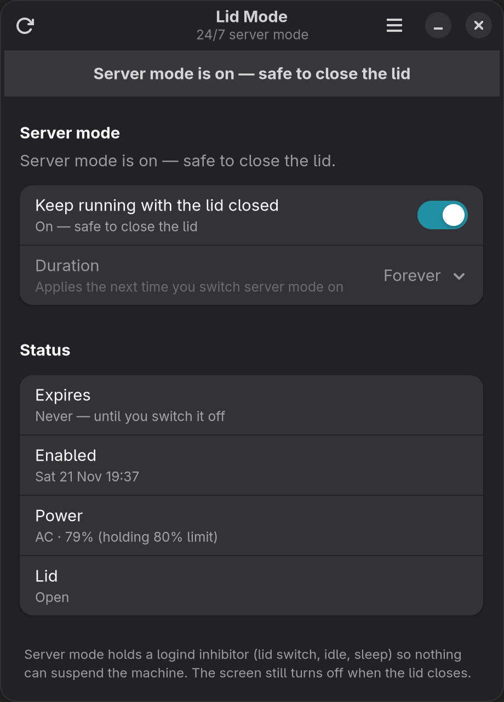

# Lid Mode

Turn a Linux laptop into a small always-on machine: with **server mode** on,
closing the lid switches the screen off but the computer keeps running — no
suspend, no idle sleep — so SSH sessions, downloads, builds and background
servers stay alive.

- **On** — holds a logind block inhibitor (`handle-lid-switch`, `idle`, `sleep`)
  for as long as you want, then releases it.
- **Off** — normal laptop behaviour: lid close suspends, the idle timer
  suspends.
- No root, no daemon, no boot-time service. Nothing about the machine is
  permanently changed.



## Install

Requires Python 3 with PyGObject, GTK 4 and libadwaita (the default on Fedora,
Ubuntu, Debian, Arch GNOME installs), plus systemd/logind.

### From a release tarball

Download `lidmode-<version>.tar.gz` from
[Releases](https://github.com/thoaikhmt/lidmode/releases), then:

```bash
tar xf lidmode-*.tar.gz
cd lidmode-*/
./install.sh
```

### From source

```bash
git clone https://github.com/thoaikhmt/lidmode.git
cd lidmode
./install.sh
```

`install.sh` symlinks `lidmode` and `lidmode-app` into `~/.local/bin` and
installs the desktop entry, icon and AppStream metadata for the current user.
Remove the shortcuts with `./install.sh --uninstall`.

## Use the app

Launch **Lid Mode** from the app grid:

- **Server mode** — switch "Keep running with the lid closed", plus a duration
  picker (1 h / 4 h / 8 h / 24 h / **Forever**, the default).
- **Status** — expiry, when it was enabled, power source/battery state and lid
  state.
- A banner when it's on, and a battery warning when it's on and unplugged.

Closing the window does not stop server mode: the app keeps running in the
background while the inhibitor is held. Reopen it from the app grid to switch it
off, or use the CLI.

## Use the CLI

```bash
lidmode on            # until you turn it off
lidmode on 8h         # optional timer: 90m, 1d, 1h30m, 3600
lidmode status
lidmode status --json # machine-readable
lidmode off
lidmode toggle
```

Example:

```
● Server mode ON — until you turn it off
  power     AC · battery 79% (holding 80% limit)
  lid       open
  since     Sat 21 Nov 19:30
  unit      lidmode-awake.service
```

Keybindings:

```bash
lidmode-app --toggle   # flip state
```

Suggested shortcut: Settings → Keyboard → Custom Shortcuts →
`lidmode-app --toggle` on e.g. `Super+F12`.

## How it works

- **Normal installs:** `lidmode on` starts a transient `systemd --user` unit
  running `systemd-inhibit --what=handle-lid-switch:idle:sleep --mode=block
  sleep infinity`. The unit is not enabled at boot and disappears when you turn
  server mode off.
- **Sandboxed builds:** if the app detects `/.flatpak-info`, it calls
  `org.freedesktop.login1.Manager.Inhibit()` over the system bus and keeps the
  returned file descriptor open — the same mechanism `systemd-inhibit` uses.
  Such a build needs `--system-talk-name=org.freedesktop.login1`.

The screen is untouched either way: Mutter switches the panel off on lid close
and GNOME still locks/blanks on idle. The CPU, network and your processes keep
running.

Power state is read from sysfs, including vendor charge thresholds, so a
ThinkPad sitting at its 80% charge limit shows `holding 80% limit` rather than
a misleading `Not charging`, and USB-C ports are not mistaken for mains power.

## Caveats

- **Heat.** A closed laptop still vents. Keep it on a hard surface with the
  vents clear; don't leave it running closed inside a bag.
- **Battery.** Server mode does not stop the battery from draining; the app
  warns when you enable it on battery.
- **Session lifetime.** The inhibitor lives in your user systemd manager (or in
  the app process for sandboxed builds), so it ends on logout/reboot or when the
  app quits.
- **Reboot.** Not persistent by design — turn server mode on again after
  rebooting.
- Manual suspend is blocked while server mode is on.

## Repository layout

```
bin/lidmode                 CLI + systemd/logind logic
bin/lidmode-app             GTK4/libadwaita GUI
data/io.github.thoaikhmt.LidMode.desktop
data/io.github.thoaikhmt.LidMode.metainfo.xml
data/icons/hicolor/scalable/apps/io.github.thoaikhmt.LidMode.svg
data/screenshots/{on,off}.png
install.sh
```

There is deliberately no Flatpak manifest in this repository. If you want to
package Lid Mode yourself, the app exposes everything a sandboxed build needs
(the logind backend and the `/.flatpak-info` detection) and its AppStream
metadata and desktop entry are ready to be installed under `/app`.

## License

MIT — see [LICENSE](LICENSE).
